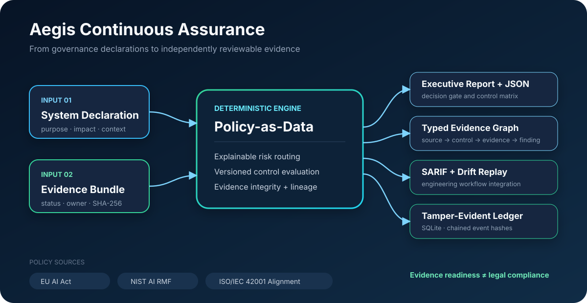

# Aegis: AI Governance Continuous Assurance

[](https://github.com/JithuVathiath/ai-governance-continuous-assurance/actions/workflows/quality.yml)
[](https://go.dev/)
[](LICENSE)
[](docs/methodology.md)

**Aegis turns AI governance requirements into testable, traceable evidence checks.** It routes an AI system to an explainable risk tier, evaluates versioned policy packs, verifies evidence integrity, generates board-readable and machine-readable outputs, records each run in a tamper-evident ledger, and reveals governance drift between releases.

This is a portfolio-grade reference implementation for AI governance, model risk, responsible AI, assurance, and technology consulting. It makes no legal-compliance claim.



## Why This Is Different

Most governance repositories stop at a checklist or static questionnaire. Aegis treats governance as an engineering system:

- **Evidence graph:** every applicable control links to the exact artefacts used to support it.
- **Versioned policy-as-data:** EU AI Act, NIST AI RMF, and high-level ISO/IEC 42001 alignment packs are fingerprinted in every assessment.
- **Tamper evidence:** a SQLite event ledger chains assessment payloads with SHA-256 hashes and detects later modification.
- **Control-drift replay:** release-to-release comparison identifies newly applicable, resolved, and regressed controls.
- **Honest decision gates:** high-severity evidence gaps create a hold; coverage is never called a compliance score.
- **Engineering outputs:** one run produces JSON, an executive Markdown report, a typed evidence graph, SARIF for GitHub, and a ledger receipt.
- **Adversarial examples:** the repository includes expired, draft, missing, and approved evidence—not a misleading all-green showcase.

## Demonstrated Results

These outputs are generated from the committed synthetic case studies at a fixed assessment time; no metrics are placeholders.

| Case Study | Routing | Supported Controls | Evidence Coverage | Decision |
| --- | --- | ---: | ---: | --- |
| Recruitment screening v1 | High | 8 / 15 | 53.3% | **Hold** |
| Recruitment screening v2 | High | 14 / 17 | 82.4% | **Hold** |
| Consumer credit scoring | High | 14 / 15 | 93.3% | **Hold** |
| Customer support assistant | Transparency | 11 / 11 | 100.0% | **Ready for independent review** |
| Foundation-model procurement | Minimal | 6 / 7 | 85.7% | **Conditional review** |

The recruitment change replay finds **2 newly applicable controls, 7 resolved controls, and 1 regression** after a generative explanation feature is introduced. See the [drift report](reports/recruitment-screening-drift.md) and [version 2 assurance report](reports/recruitment-screening-v2.md).

## Sixty-Second Demo

Requirements: Go 1.27 or later.

```bash
git clone https://github.com/JithuVathiath/ai-governance-continuous-assurance.git
cd ai-governance-continuous-assurance
make demo
```

The command rebuilds five deterministic assessments, five reports, five SARIF files, a recruitment control-drift replay, and a five-event ledger verification. The main outputs are in [`reports/`](reports/) and [`artifacts/public/`](artifacts/public/).

Prefer a container? Build the included non-root image and mount the repository as the working directory:

```bash
docker build -t aegis .
docker run --rm -v "$PWD:/workspace" aegis version
```

Run the full quality gate:

```bash
make verify
```

Run the pinned source and dependency security audits with `make security`.

## Assess Your Own System

Create a system declaration and evidence bundle using the files in [`cases/`](cases/) as examples, then run:

```bash
go run ./cmd/aegis assess \
  --system cases/consumer-credit-scoring/system.json \
  --evidence cases/consumer-credit-scoring/evidence.json \
  --policies policies \
  --out assessment.json \
  --report assessment.md \
  --sarif assessment.sarif \
  --ledger aegis-ledger.db
```

Compare two system versions:

```bash
go run ./cmd/aegis diff \
  --before artifacts/public/recruitment-screening-v1.assessment.json \
  --after artifacts/public/recruitment-screening-v2.assessment.json \
  --out drift.json \
  --report drift.md
```

Verify the full audit chain:

```bash
go run ./cmd/aegis verify-ledger --ledger aegis-ledger.db
```

## Decision Logic

| Outcome | Meaning |
| --- | --- |
| `ready-for-independent-review` | Every applicable control has sufficient approved, hash-verified evidence. Independent review is still required. |
| `conditional-review` | Only lower-severity gaps remain; they must be reviewed before release. |
| `hold` | A high/critical evidence gap or declared risk-tier mismatch requires escalation. |

Evidence states are `supported`, `partial`, `missing`, or `expired`. Applicability is deterministic and reviewable: values are ORed within one condition field and ANDed across populated fields.

## Policy Sources and Boundaries

Policy packs are original, concise mappings to public framework concepts:

- [European Commission: EU AI Act regulatory framework](https://digital-strategy.ec.europa.eu/en/policies/regulatory-framework-ai)
- [NIST AI Risk Management Framework](https://www.nist.gov/itl/ai-risk-management-framework)
- [ISO/IEC 42001 official overview](https://www.iso.org/standard/42001)

The ISO pack intentionally uses only high-level original descriptions. It does not reproduce the standard or assess certification. Full source, version, interpretation, and maintenance notes are in [Policy Sources](docs/policy-sources.md).

## Repository Map

```text
cmd/aegis/           CLI entry point
internal/            routing, policy engine, ledger, drift, reports, SARIF
policies/            versioned policy packs
cases/               synthetic systems and human-readable evidence
schemas/             JSON Schemas for declarations and evidence bundles
artifacts/public/    reproducible JSON and SARIF outputs
reports/             recruiter- and board-readable assurance reports
docs/                architecture, methodology, threat model, decisions
```

## Responsible Use

Aegis is decision support for governance teams. It is not legal advice, certification, conformity assessment, or a substitute for qualified legal, security, risk, accessibility, model-validation, worker, consumer, or domain review. The case studies are fictional and use no personal or confidential data. Read [Responsible Use](docs/responsible-use.md) and the [Threat Model](docs/threat-model.md) before adapting it.

## Project Status

Version `0.1.0` is a complete reference release: CLI, three policy packs, five assessments across four scenarios, evidence-integrity checks, SQLite hash-chain ledger, drift analysis, SARIF export, tests, Docker packaging, CI, and documentation. See the [roadmap](docs/roadmap.md) for deliberately scoped future work.

## Author

**Jithu Vathiath Biju** — AI governance, data science, technology strategy, and responsible innovation.

Contributions and careful critique are welcome. See [Contributing](CONTRIBUTING.md) and [Security](SECURITY.md).
